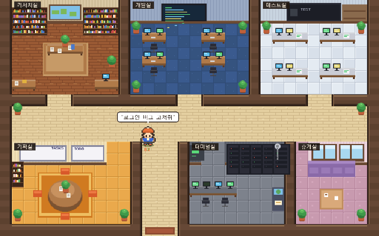
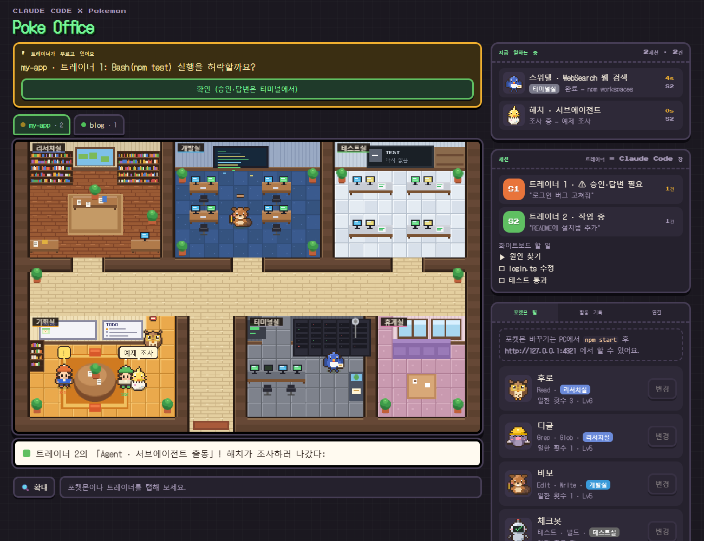
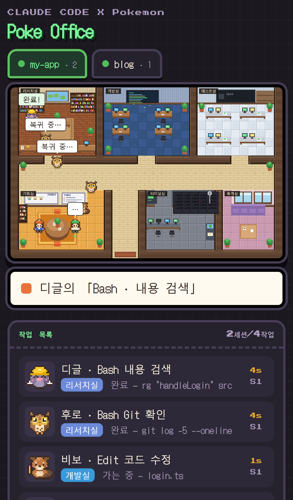

# 포켓 오피스 — Claude Code가 일하는 모습을 포켓몬 사무실로

터미널 글자만 보고 Claude Code가 지금 뭘 하는지 한눈에 보기 어려우셨죠?
**포켓 오피스**는 Claude Code의 작업을 포켓몬들이 일하는 픽셀 사무실로 보여줘요!

<p align="center"></p>

- Claude가 툴을 쓰면 **트레이너가 볼을 던져 담당 포켓몬을 꺼내고**, 포켓몬이 그 방으로 가서 실제 툴 이름으로 기술을 써요. 예: 「Read · 파일 읽기」, 「Bash · 테스트 실행」
- 일이 끝나면 결과를 들고 트레이너에게 돌아와 **다시 볼 안으로** 들어가요.
- 방만 봐도 지금 단계가 보여요: **리서치실**(조사) → **개발실**(수정) → **테스트실**(검증), 그 밖의 명령·외부 연결은 **터미널실**
- Claude Code 세션 하나가 트레이너 한 명이에요. 기획실 원탁에서 지시를 내리고, 답변이 끝나면 **휴게실**로 가서 쉬면서 다음 지시를 기다려요.
- 프로젝트 폴더마다 사무실이 따로 생겨요(상단 탭).

> 위 이미지의 몬스터는 이 프로젝트용 오리지널 픽셀 아트입니다. 본 레포를 설치하면 원하는 포켓몬으로 바꿀 수 있어요(아래 [포켓몬 바꾸기](#포켓몬-바꾸기)).

## 미리보기

| 데스크톱 | 모바일 |
| --- | --- |
|  |  |

## 동작 방식

```
┌ 리서치실 ┬ 개발실 ┬ 테스트실 ┐
├──────────── 복도 ────────────┤
│ 기획실 │ 입구 │ 터미널실 │ 휴게실 │
```

| 방 | 단계 | 들어오는 툴 (기술 이름) |
| --- | --- | --- |
| 리서치실 | 조사 | `Read` 파일 읽기 · `Grep` 내용 검색 · `Glob` 파일 찾기 · `LSP` 코드 분석 · 읽기 전용 `Bash` (`rg`/`grep` 내용 검색, `find`/`ls` 파일 찾기, `cat`/`head` 파일 읽기, `git status/log/diff` Git 확인) |
| 개발실 | 수정 | `Edit` 코드 수정 · `Write` 파일 작성 · `NotebookEdit` |
| 테스트실 | 검증 | `Bash` 중 테스트 실행(`npm test`, `pytest`, `jest`…) · 린트 검사 · 타입 검사(`tsc`) · 빌드. 벽의 상태판에 마지막 결과 ✓/✗ |
| 터미널실 | 실행·외부 | 그 밖의 `Bash` (패키지 설치, Git 커밋·푸시, 서버 실행, 명령 실행) · `Monitor` · `WebSearch` 웹 검색 · `WebFetch` 웹페이지 읽기 · MCP 도구 (예: 「Slack · post message」) |
| 기획실 | 계획 | 트레이너(세션) · `TodoWrite`/`TaskCreate` 할 일 정리 · `ExitPlanMode` 계획 제출 · `Skill` · `Agent` 서브에이전트 출동 |
| 휴게실 | 휴식 | 답변이 끝나면(`Stop`) 트레이너가 소파에서 다음 지시를 기다림 |

macOS·Linux의 Claude Code는 검색을 `Grep`/`Glob` 대신 `Bash`(`rg`, `find`)로 하는 경우가 많아서, **Bash는 명령 내용을 보고 방을 나눠요.**

| 이벤트 | 화면 |
| --- | --- |
| 세션 시작 / 종료 | 트레이너가 입구로 출근해 기획실 원탁에 앉음 / 퇴근 |
| 프롬프트 입력 | 트레이너 말풍선, 휴게실에 있었다면 기획실로 복귀 |
| 툴 시작 → 끝 | 트레이너가 볼을 던짐 → 옆에 포켓몬 등장 → 담당 방 자리로 가서 일함 → 결과를 들고 돌아와 빨간 빛과 함께 볼로 들어감 (화면에 나와 있는 포켓몬 = 지금 그 일을 하는 중) |
| 툴 동시 호출 | 여러 포켓몬이 동시에 나타남 |
| 툴 실패 | 포켓몬이 시무룩해짐 (테스트 실패면 상태판 ✗) |
| 서브에이전트 (`Agent`) | 조수 포켓몬이 볼에서 나와 사무실을 돌며 조사하고, 끝나면 돌아와 볼로 |
| 권한 요청 · `AskUserQuestion` | 트레이너 머리 위 "!"/"?" + 화면 상단 알림 (답은 터미널에서) |
| 답변 끝 (`Stop`) | 트레이너가 휴게실로 |


## 설치

필요한 것: **Node.js 18 이상**, **git**

```bash
git clone https://github.com/YuuuuuRAE/poke-office.git
cd poke-office
npm run install:all   # 스프라이트 받기 + Claude Code 연결 + 바탕화면 아이콘
```

Windows라면 클론한 폴더의 **`install.cmd`** 를 더블클릭해도 돼요. 설치가 끝나면 서버까지 바로 켜져요.

그다음부터는 바탕화면의 **Poke Office** 아이콘만 누르면 돼요. 누를 때마다 GitHub에 새 버전이 있으면 먼저 받아온 뒤 서버를 켜고 브라우저를 열어요. (macOS는 `Poke Office.command` 파일이 만들어져요.)

<details><summary>하나씩 직접 하기</summary>

```bash
npm install          # 포켓몬 스프라이트를 자동으로 받아요 (약 10MB, 몇 초)
npm run hooks        # Claude Code에 연결
npm run shortcut     # 바탕화면 아이콘 (지우기: npm run shortcut:remove)
npm start            # http://127.0.0.1:4321
```
</details>

브라우저에서 **http://127.0.0.1:4321** 을 열어 두면, Claude Code를 쓸 때 사무실이 움직여요.
스프라이트 받기가 실패했다면 `npm run setup` 으로 다시 받을 수 있어요.

## 포켓몬 바꾸기

설치한 앱을 처음 열면 **추천 포켓몬으로 바로 시작**해요. 바꾸고 싶으면:

1. `npm start` 후 **http://127.0.0.1:4321** 에서 오른쪽 **내 파티** 탭을 열어요.
2. 바꾸고 싶은 역할 옆 **변경**을 누르면 가운데에 **포켓몬 도감**이 열려요.
3. 전체 포켓몬을 스크롤하거나 이름(한국어/영어)·도감 번호로 검색해서 고르면 바로 바뀌어요. **이로치**도 고를 수 있어요.

고른 포켓몬은 브라우저에 저장돼요. **오리지널 몬스터로 바꾸기**를 누르면 이 프로젝트의 기본 몬스터로 돌아가요.

| 역할 | 방 | 추천 |
| --- | --- | --- |
| Read · 파일 읽기 | 리서치실 | 후딘 #65 |
| Grep · Glob · 검색 | 리서치실 | 디그다 #50 |
| Edit · Write | 개발실 | 루브도 #235 |
| 테스트 · 린트 · 빌드 | 테스트실 | 코일 #81 |
| Bash (그 밖의 명령) | 터미널실 | 폴리곤 #137 |
| WebSearch · WebFetch | 터미널실 | 딜리버드 #225 |
| MCP 도구 | 터미널실 | 로토무 #479 |
| 서브에이전트 | 기획실 | 메타몽 #132 |

## Claude Code 연결

poke-office 폴더에서 한 줄이면 돼요.

```bash
npm run hooks
```

`~/.claude/settings.json` 에 훅 8개를 넣어줘요. 기존 설정과 다른 훅은 그대로 두고 합치며, 바꾸기 전에 백업 파일(`settings.json.bak-날짜`)을 만들어요. 여러 번 실행해도 중복으로 들어가지 않아요.

- 폴더를 옮겼다면 다시 실행하세요.
- 빼고 싶으면 `npm run hooks:remove` (포켓 오피스 훅만 지워요).
- Claude Code가 이미 켜져 있었다면 새로 실행해야 설정을 읽어요. Claude Code 안에서 `/hooks` 로 들어갔는지 볼 수 있어요.

<details>
<summary>직접 설정하기 (수동)</summary>

`~/.claude/settings.json`(윈도우: `C:\Users\<이름>\.claude\settings.json`)에 아래를 넣으세요. `/절대경로/poke-office` 는 이 폴더의 실제 경로(`pwd` 로 확인)로 바꾸세요.

```json
{
  "hooks": {
    "SessionStart":     [{ "hooks": [{ "type": "command", "command": "node /절대경로/poke-office/hook.mjs" }] }],
    "UserPromptSubmit": [{ "hooks": [{ "type": "command", "command": "node /절대경로/poke-office/hook.mjs" }] }],
    "PreToolUse":       [{ "matcher": "", "hooks": [{ "type": "command", "command": "node /절대경로/poke-office/hook.mjs" }] }],
    "PostToolUse":      [{ "matcher": "", "hooks": [{ "type": "command", "command": "node /절대경로/poke-office/hook.mjs" }] }],
    "Notification":     [{ "hooks": [{ "type": "command", "command": "node /절대경로/poke-office/hook.mjs" }] }],
    "SubagentStop":     [{ "hooks": [{ "type": "command", "command": "node /절대경로/poke-office/hook.mjs" }] }],
    "Stop":             [{ "hooks": [{ "type": "command", "command": "node /절대경로/poke-office/hook.mjs" }] }],
    "SessionEnd":       [{ "hooks": [{ "type": "command", "command": "node /절대경로/poke-office/hook.mjs" }] }]
  }
}
```
</details>

`npm start` 로 서버를 켜둔 채 Claude Code를 쓰면 화면이 **LIVE** 로 바뀌고 실제 작업을 따라 움직여요.

- 훅은 이벤트를 서버로 보내기만 하고 바로 끝나요. 서버가 꺼져 있어도 Claude Code는 평소처럼 동작해요.
- 권한 요청 알림은 화면에 표시만 돼요. 승인은 터미널에서 해주세요.
- Claude가 툴 없이 글만 쓰는 동안은 훅이 오지 않아서 트레이너가 "…" 말풍선만 보여요.

## 안 될 때

```bash
npm run doctor
```

Node·git·스프라이트·서버·훅 연결을 차례로 확인하고, 문제가 있으면 고치는 방법을 알려줘요. 자주 있는 경우:

- **포켓몬 변경 버튼이 회색**: 주소가 `http://127.0.0.1:4321` 이 아니에요. index.html을 직접 열거나 claude.ai 링크로 보면 포켓몬을 바꿀 수 없어요.
- **스프라이트가 없음**: macOS에서 git이 없으면 받지 못해요. `xcode-select --install` 후 `npm run setup`. (서버를 켤 때 스프라이트가 없으면 자동으로 다시 받아요.)

## 화면 보는 법

- **작업 목록**: 어떤 포켓몬이 어느 방에서 무슨 파일·명령을 처리하는지, 몇 초째인지
- **세션**: Claude Code 창(트레이너)별 상태와 마지막 프롬프트, 화이트보드 할 일. **세션 찾기**를 누르면 최근 1시간 안에 쓴 Claude Code 세션을 대화 기록 폴더에서 찾아 바로 불러와요 (서버를 켜기 전부터 열려 있던 창도 보여요)
- **퇴근**: Claude Code를 종료하면(`/exit`, `Ctrl+C` 등) 트레이너가 출입문으로 나가요. 창을 그냥 닫아 종료 신호가 안 오더라도 30분 동안 아무 신호가 없으면 퇴근해요. 트레이너가 모두 나가면 그 탭도 닫히고, 다시 프롬프트를 보내면 출근해요.
- **프로젝트 탭 우클릭**: 지도 위쪽 탭은 작업 폴더(프로젝트)마다 하나씩 생겨요. 우클릭해서 **이름 수정**(이 화면에서만)나 **삭제**(그 폴더의 트레이너를 모두 화면에서 닫기)를 할 수 있어요.
- **세션 우클릭**: 지도 위 트레이너나 세션 카드를 우클릭하면 메뉴가 떠요. **이름 수정**(이 화면에서만)와 **삭제**(화면에서만 닫기, 그 세션에 새 프롬프트를 보내면 다시 나타남)를 할 수 있어요.
- **recap**: 자리를 비운 사이 Claude Code가 남긴 요약(recap)은 활동 기록에 쌓이고, 트레이너 머리 위에 초록 느낌표가 떠요. 누르면 팝업으로 보여줘요.
- **작업 타임라인**: 기본은 **요청별** 보기예요. 프롬프트 하나부터 답변이 끝날 때까지를 카드 한 장으로 보여줘요.
  - 카드에는 보낸 요청, 걸린 시간, 결과(완료 / 테스트 실패 / 중단 / 승인 대기), 툴 개수(조사 12 / 수정 3 …), 수정한 파일이 나와요.
  - 색 막대는 시간 분배예요. 방별 작업 시간과 승인 대기(주황 줄무늬), 그 밖의 생각 / 답변 작성 시간을 보여줘요.
  - **토큰**: 요청마다 출력 토큰과 새 입력 토큰(캐시 제외)을 보여줘요. 카드에 마우스를 올리면 현재 컨텍스트 크기도 나와요. 서버가 대화 기록에서 읽어요(메인 대화만, 서브에이전트 제외).
  - 카드를 누르면 시간 분배, 토큰, 수정한 파일, 실행한 순서를 자세히 볼 수 있어요.
  - **토큰 분석** (요약 줄 버튼이나 세션 우클릭): 세션의 대화 기록 전체를 읽어 어디서 토큰이 많이 드는지 보여줘요. 하네스나 에이전트 루프를 최적화할 때 쓰세요.
    - 지금 컨텍스트 구성: 기본 컨텍스트, 툴 결과(툴별), Claude 출력, 주입된 내용(리마인더 / 훅 / 첨부)
    - 기본 컨텍스트: 시스템 프롬프트, 기본 툴 정의, MCP 서버별 툴 정의, 처음 주입된 내용(CLAUDE.md / 메모리 등)
    - 많이 쓴 곳 TOP 10: 들어온 크기와 이후 다시 읽힌 양(누적 재읽기)
    - 반복된 작업, 캐시를 다시 만든 때, 서브에이전트별 사용량, 툴 정의 크기
    - 줄일 수 있는 곳: 위 결과로 만든 짧은 제안
    - 요청 카드를 누르면 그 요청에서 컨텍스트를 키운 것도 함께 보여줘요.
    - 값은 응답마다 늘어난 컨텍스트를 그 사이에 들어온 내용에 나눠 붙인 근사치예요.
  - **시간축** 보기로 바꾸면 예전처럼 툴 실행을 시간순 블록으로 볼 수 있어요 (1분 / 5분 / 15분 / 1시간).
- **사용 한도 (오른쪽 위)**: Claude 5시간 · 주간 한도의 남은 양을 HP 바로 보여줘요. Claude Code 상태줄(statusLine)이 받은 `rate_limits` 를 `~/.claude/statusline-cache.json` 에 저장해 둔 경우에만 보여요
- **내 파티**: 역할별 포켓몬과 일한 횟수, **변경** 버튼으로 포켓몬 바꾸기
- **활동 기록**: 보낸 프롬프트, 툴 실행, Claude가 CLI에 남긴 말. **전체 기록 보기**로 모두 볼 수 있어요
- **연결**: 서버 연결 상태와 연결 구조
- 글이 잘린 곳은 오른쪽 **▾** 버튼이나 기록 줄을 누르면 가운데 팝업으로 원문 전체가 보여요

## 화면 조작

- 방에 마우스를 올리면 설명이 뜨고, **클릭하면** 그 방에서 지금 일어나는 일을 팝업으로 보여줘요
- 트레이너나 포켓몬을 **꾹 눌러 잡고** 옮길 수 있어요. 잡힌 동안 바둥거리고, 놓으면 하던 일로 걸어 돌아가요
  - **던지기**: 잡은 채로 휙 놓으면 날아가요. 벽에 부딪히면 "쿵!" 하고 잠깐 어지러워해요.
  - **오래 잡기**: 3초가 넘으면 화를 내요. 포켓몬은 6초가 넘으면 몬스터볼에 들어갔다 나오고, 트레이너는 "놔 주세요!" 해요.
  - **내려놓은 자리**: 다른 방이면 "여기 아닌데…?", 휴게실이면 잠깐 쉬었다 가요. 다른 포켓몬 옆이면 서로 인사하고(같은 종류면 하트), 자기 트레이너 옆이면 쓰다듬어 줘요.
  - 모두 화면 연출이라 Claude Code 작업에는 영향이 없어요.

## 구조

```
index.html                  화면 (Canvas, 의존성 없음)
server.mjs                  로컬 서버: 화면, /sprites, /api/names, POST /events, GET /stream (SSE)
hook.mjs                    Claude Code 훅 입력 → OfficeEvent 로 변환해 서버로 전송
scripts/setup-sprites.mjs   PokeAPI 스프라이트·이름 데이터 sparse checkout
scripts/install-hooks.mjs   ~/.claude/settings.json 에 훅 추가/제거 (npm run hooks)
scripts/doctor.mjs          설치·연결 진단 (npm run doctor)
scripts/install-shortcut.mjs 바탕화면 실행 아이콘 만들기/지우기 (npm run shortcut)
scripts/start.cmd           아이콘이 실행하는 파일: 업데이트 확인 → 서버 시작 → 브라우저 열기
install.cmd                 Windows 한 번에 설치 (npm run install:all 후 실행)
docs/                       README 이미지
vendor/                     (자동 생성, git 제외) 받은 스프라이트와 names.json
```

서버는 `127.0.0.1` 에서만 열려요. 포트는 `POKE_OFFICE_PORT` 환경 변수로 바꿀 수 있어요.

## 저작권 안내

- 포켓몬 스프라이트와 이름의 권리는 Nintendo / Game Freak / The Pokémon Company에 있어요. 이 저장소에는 포켓몬 이미지가 들어 있지 않고, `npm install` 때 [PokeAPI/sprites](https://github.com/PokeAPI/sprites)에서 각자의 PC로 받아져요(`vendor/`, git 제외).
- 개인적으로만 쓰고, 포켓몬 스프라이트가 나온 화면을 녹화해 공개하거나 재배포하지 마세요.
- 이 프로젝트는 Nintendo, Game Freak, The Pokémon Company와 관계가 없어요.
- 기본 몬스터·트레이너·사무실 그림과 코드는 이 프로젝트에서 직접 만든 것이에요 (MIT License).

## 참고

- [pixel-agents](https://github.com/pablodelucca/pixel-agents): Claude Code 에이전트를 픽셀 오피스 캐릭터로 보여주는 VS Code 확장. 이 프로젝트의 출발점이 된 아이디어예요.
- [Claude Code hooks 문서](https://code.claude.com/docs/en/hooks)
